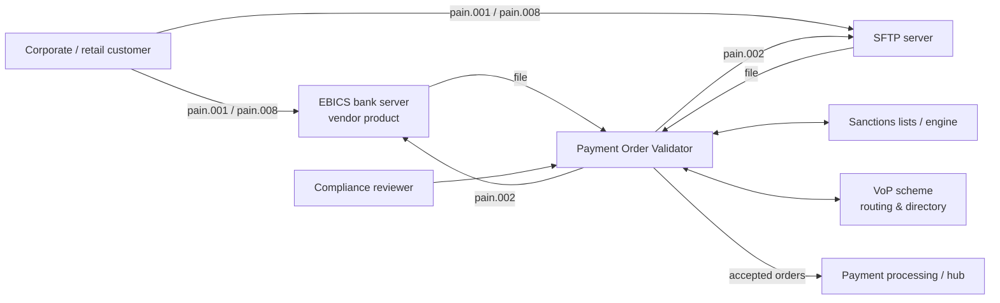
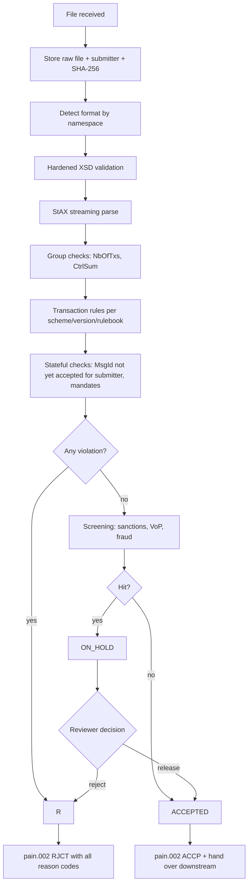

# SEPA Payment Order Validator — Design

| | |
|---|---|
| **Status** | Draft |
| **Date** | 2026-10-31 |
| **Owner** | Waldemar Kindler |
| **Decisions** | See [`docs/adr/`](../adr/README.md) |

## 1. Purpose

Customers of the bank submit SEPA payment order files (credit transfers, instant credit transfers, direct debits) via EBICS and SFTP. Before any order is executed, the bank must:

1. verify the file is technically and semantically correct against the German DK format specification and the EPC rulebooks,
2. verify it is not a duplicate,
3. verify direct debits against the mandate history the bank holds,
4. screen it (sanctions, Verification of Payee, fraud),
5. report the outcome back to the customer as an ISO 20022 `pain.002` status report.

The Payment Order Validator is the system that does this. It sits between the customer channels (EBICS bank server, SFTP) and the downstream payment processing.

## 2. Scope

### In scope

| Area | Detail |
|---|---|
| Schemes | SEPA Credit Transfer (SCT), SEPA Instant Credit Transfer (SCT Inst), SEPA Direct Debit Core and B2B (SDD) |
| Message formats | All DK-supported versions: `pain.001.001.03`, `pain.001.001.09`, `pain.001.003.03`, `pain.008.001.02`, `pain.008.001.08`, `pain.008.003.02`, plus DK container files |
| Market rules | German DK specification (DFÜ-Abkommen, Anlage 3) on top of EPC rulebooks |
| Processing | Batch files, asynchronous, stateful |
| Channels | EBICS (via bank server), SFTP |
| Outcome | Whole-file acceptance or rejection, reported as `pain.002` |
| Screening | Sanctions screening, Verification of Payee (VoP), fraud checks |
| Mandates | SDD mandate store owned by this system |

### Out of scope (for now)

- Execution / booking of payments and interbank messaging (`pacs.*`)
- Implementing the EBICS protocol itself (see [ADR-0009](../adr/0009-integrate-with-ebics-bank-server.md))
- Customer-facing UI for file upload

## 3. Context



## 4. Architecture

A **modular monolith** built with Spring Boot and Spring Modulith ([ADR-0002](../adr/0002-modular-monolith-with-spring-modulith.md)). Modules communicate through published application events; module boundaries are verified in tests.

| Module | Responsibility |
|---|---|
| `intake` | Receive files from EBICS and SFTP (polled by the elected leader instance only, [ADR-0015](../adr/0015-leader-election-with-postgresql-locks.md)), claim each file by atomic rename to `processing/<file id>-<name>`, store it idempotently with its authenticated submitter and SHA-256, archive it, start processing ([ADR-0007](../adr/0007-asynchronous-processing-with-file-lifecycle.md)) |
| `validation` | Format detection, XSD validation, streaming parse, rule evaluation |
| `mandates` | SDD mandate store, mandate history, mandate lifecycle rules, management API |
| `screening` | Sanctions, VoP and fraud checks, each behind its own port |
| `review` | Queue of files on hold, reviewer decisions, release / reject |
| `reporting` | Generate `pain.002`, deliver via the channel the file arrived on |
| `audit` | Append-only record of every file, violation, decision and report |

Internally each module follows a ports-and-adapters layout: the domain (model and rules) has no Spring dependency; adapters (persistence, SFTP, HTTP) live at the edge.

## 5. Processing pipeline



### 5.1 File lifecycle

```
RECEIVED → VALIDATING → REJECTED
                      → SCREENING → ACCEPTED
                                  → ON_HOLD → RELEASED (→ ACCEPTED)
                                            → REJECTED
```

Every transition is persisted and written to the audit log ([ADR-0007](../adr/0007-asynchronous-processing-with-file-lifecycle.md)).

### 5.2 Whole-file rejection

Any validation violation rejects the entire file (`GrpSts = RJCT`). The validator still evaluates **all** rules and reports **every** violation in the `pain.002`, so the customer can fix the file in one round trip ([ADR-0006](../adr/0006-whole-file-rejection-collecting-all-violations.md)).

## 6. Validation rules

Rules are small, independent classes implementing a common interface. A `RuleSet` is selected by format, message version and the rulebook version effective on the requested execution / collection date ([ADR-0005](../adr/0005-format-detection-and-versioned-rule-sets.md)).

```java
public interface ValidationRule<T> {
    List<Violation> validate(T subject, ValidationContext context);
}

public record Violation(
        String reasonCode,   // ISO 20022 external status reason code, e.g. AC01
        String path,         // location in the file, e.g. PmtInf[2]/CdtTrfTxInf[17]/CdtrAcct/Id/IBAN
        String message,
        Severity severity) {}
```

### 6.1 Rule catalogue (initial)

**File / group level**

| Rule | Reason code |
|---|---|
| File is well-formed XML and valid against the XSD of its namespace | FF01 |
| `GrpHdr/NbOfTxs` equals actual transaction count | AM18 |
| `GrpHdr/CtrlSum` equals sum of amounts | AM10 |
| Same checks per `PmtInf` | AM18 / AM10 |
| `MsgId` not yet accepted for the same submitter ([ADR-0016](../adr/0016-duplicate-detection-by-message-id.md)) | DU01 |
| `PmtInfId` unique within file | DU02 |
| `PmtInfId` unique per submitter across files (not yet implemented) | DU02 |

**Transaction level — all schemes**

| Rule | Reason code |
|---|---|
| IBAN: country, length, mod-97 check digits | AC02 (debtor) / AC03 (creditor) |
| BIC format (8 or 11) — enforced by the XSD; debtor agent identified by `BICFI` or `Othr/Id`, creditor agent only as `BICFI` (EPC C2PSP IG 2.54, 2.114) | FF01 / RC01 |
| Currency is `EUR` | AM03 |
| Amount ≥ 0.01, ≤ 999,999,999.99, ≤ 2 decimals (EPC C2PSP IG 2.95) | AM01 / AM02 / AM12 |
| Character set: DK extended Latin set; conversion for interbank use | CH16 / FF01 |
| Field lengths: party names 70 (initiating party, debtor, creditor, ultimate parties); remittance 140 and End-to-End ID 35 via the XSD | FF01 |
| One structured **or** one unstructured remittance, not both; structured ≤ 140 characters including tags (EPC C2PSP IG 2.164–2.166) | FF01 |
| Creditor reference has type and reference, coded type is `SCOR`. ISO 11649 check digits are not validated: EPC C2PSP IG 2.175 does not require it and lets the PSP continue on failure | FF01 |
| Creditor name present (EPC C2PSP IG 2.117) | RR03 |
| Debtor and creditor postal address: at most 2 `AdrLine`; structured or hybrid (`TwnNm` and `Ctry`) for a requested execution date on or after 22 November 2026, before that also unstructured (only `AdrLine` and `Ctry`) — EPC C2PSP IG 1.7, 2.23, 2.118; codes pending Q7 | RR02 (debtor) / RR03 (creditor) |
| End-to-End ID unique within configurable window (not yet implemented) | DU04 |

**SCT / SCT Inst**

| Rule | Reason code |
|---|---|
| Requested execution date is a TARGET business day and not in the past | DT01 |
| SCT Inst amount within configured limits (scheme and customer) | AM02 |

**SDD Core / B2B**

| Rule | Reason code |
|---|---|
| Creditor Identifier valid (country, check digits mod-97 excluding business code) | RC01 / tbd |
| Mandate ID present, signature date not in the future | MD01 / tbd |
| Collection date respects lead time (D-1, TARGET business day) | DT01 |
| Sequence type consistent with mandate history (`FRST`/`RCUR`/`OOFF`/`FNAL`) | MD01 / tbd |
| No collection after `FNAL`; no collection on a revoked mandate | MD01 |
| Mandate not expired (36 months without collection) | MD07 |
| Amendment indicator set when mandate ID or creditor ID changes | MD02 |

Reason codes marked *tbd* are to be confirmed against the DK specification.

## 7. Screening

Screening runs only on files that pass validation. Each check sits behind a port so the provider can be swapped without touching the pipeline ([ADR-0010](../adr/0010-screening-behind-ports-with-hold-for-review.md)).

| Check | Behaviour on hit |
|---|---|
| Sanctions (EU consolidated list, UN, German national; OFAC if applicable) | File goes `ON_HOLD` for manual review |
| Verification of Payee | Result must reach the customer **before** authorisation — see open question Q3 |
| Fraud | File goes `ON_HOLD` for manual review |

## 8. Mandates

The system owns SDD mandate data ([ADR-0011](../adr/0011-own-mandate-store-built-from-collections.md)).

- Mandate history is derived from accepted `pain.008` collections (mandate ID, signature date, creditor ID, sequence type, last collection date).
- Lifecycle rules (sequence consistency, `FNAL`, 36-month expiry, amendments) are enforced in `validation` by querying `mandates`.
- A management API supports revocation and corrections.

## 9. Persistence

PostgreSQL with Flyway migrations ([ADR-0008](../adr/0008-postgresql-with-flyway.md)).

| Data | Purpose |
|---|---|
| Raw files + hash | Duplicate detection, audit, reprocessing |
| File lifecycle state | Processing, review queue |
| Message / payment / transaction identifiers | Duplicate detection |
| Violations | `pain.002` generation, audit |
| Mandates + collection history | SDD rules |
| Audit events | Traceability, regulatory evidence |
| Leader lock (`INT_LOCK`) | Leader election across instances |

## 10. Security and compliance

- Hardened XML parsing: no DTDs, no external entities, entity expansion limits ([ADR-0004](../adr/0004-streaming-xml-with-hardened-parsing.md))
- Authentication of channel adapters (mTLS / SSH keys), OAuth2 for management APIs
- IBANs and names masked in logs: no payment content is logged, IBANs are masked as a safety net ([ADR-0018](../adr/0018-structured-logging-and-operational-endpoints.md))
- Retention per German regulatory requirements (GwG, HGB/AO) balanced against GDPR; exact periods to be confirmed with Compliance
- Full traceability from received file to emitted `pain.002`

## 11. Technology

| Concern | Choice |
|---|---|
| Language / runtime | Java 25 (LTS) |
| Framework | Spring Boot 4.x, Spring Modulith |
| XML | StAX streaming parse, JAXP schema validation |
| Database | PostgreSQL, Flyway |
| Testing | JUnit 5, AssertJ, Testcontainers (PostgreSQL, SFTP), RestAssured |
| Build | Gradle (Kotlin DSL) with dependency verification — see [ADR-0003](../adr/0003-java-and-spring-boot-stack.md) |
| Supply chain | CycloneDX SBOM, cosign image signing with Vault Transit key, signature enforcement on OpenShift — see [ADR-0014](../adr/0014-supply-chain-sbom-signing-verification.md) |

## 12. Testing strategy

Test-first development; unit, integration and end-to-end tests for every feature; no mocks ([ADR-0012](../adr/0012-test-strategy-without-mocks.md)).

- **Unit:** each rule in isolation with real-world example data (IBANs, creditor IDs, DK sample files).
- **Integration:** module tests with Spring Modulith, real PostgreSQL via Testcontainers.
- **End-to-end:** a file dropped on a real SFTP container produces the expected `pain.002`.

## 13. Delivery plan

1. **Walking skeleton:** SFTP intake → namespace detection → XSD validation (`pain.001.001.09`) → 3–4 SCT rules → whole-file `RJCT`/`ACCP` → `pain.002` → audit record.
2. Complete SCT rule catalogue, group checks, duplicate detection.
3. SCT Inst specifics.
4. Remaining `pain.001` versions and DK container files.
5. SDD: `pain.008` versions, creditor identifier, mandate store and lifecycle rules.
6. EBICS bank server integration.
7. Screening: sanctions, fraud, review module.
8. VoP (dependent on Q3).

## 14. Open questions

| # | Question | Affects |
|---|---|---|
| Q1 | Which EBICS bank server product, and EBICS 3.0 BTF or legacy order types (`CCT`, `CIP`, `CDD`, `CDB`, `CCC`, `CDC`, `CRZ`/`CDZ`)? | ADR-0009, intake, reporting |
| Q2 | Sanctions and fraud: build matching ourselves or integrate an existing vendor / internal service? Which lists? | ADR-0010 |
| Q3 | VoP: which provider / routing service, and how does the result reach the customer before EBICS signature? Bulk opt-out handling? | ADR-0010, intake flow |
| Q4 | SDD: creditor side only (`pain.008`), or also debtor side (incoming `pacs.003` vs. B2B mandates)? | ADR-0011, scope |
| Q5 | Review: four-eyes principle required? UI needed? | review module |
| Q6 | Sunset dates for legacy DK versions (`.001.03`, `.003.03`, `.003.02`) — still accepted by DK? | ADR-0005 |
| Q7 | Structured / hybrid address requirement from 22 November 2026 is confirmed by EPC C2PSP IG 2025. Confirm the reason codes RR02 / RR03 and applying it by requested execution date with Compliance | Rule catalogue |
| Q9 | Retention periods for raw files and audit data | Persistence, compliance |
| Q10 | OpenShift version and admission mechanism for signature verification; Red Hat Trusted Artifact Signer / Trusted Profile Analyzer available? | ADR-0014 |
| Q11 | Which CI system builds and signs (OpenShift Pipelines/Tekton, GitLab CI, Jenkins)? | ADR-0014 |
| Q12 | How long must a `MsgId` stay unique per submitter (forever, or e.g. 90 days)? Does DK prescribe a window? | ADR-0016 |
| Q13 | Maximum accepted file size (default 100 MB) and overdue-reply threshold (default 10 min): confirm with business and operations, size pods accordingly | ADR-0004, ADR-0007 |
